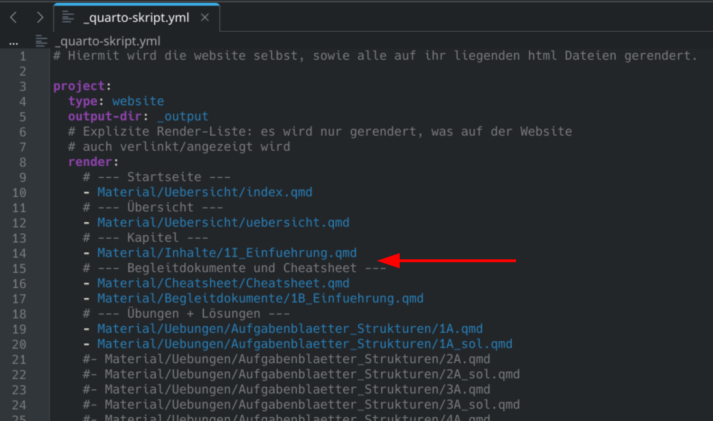
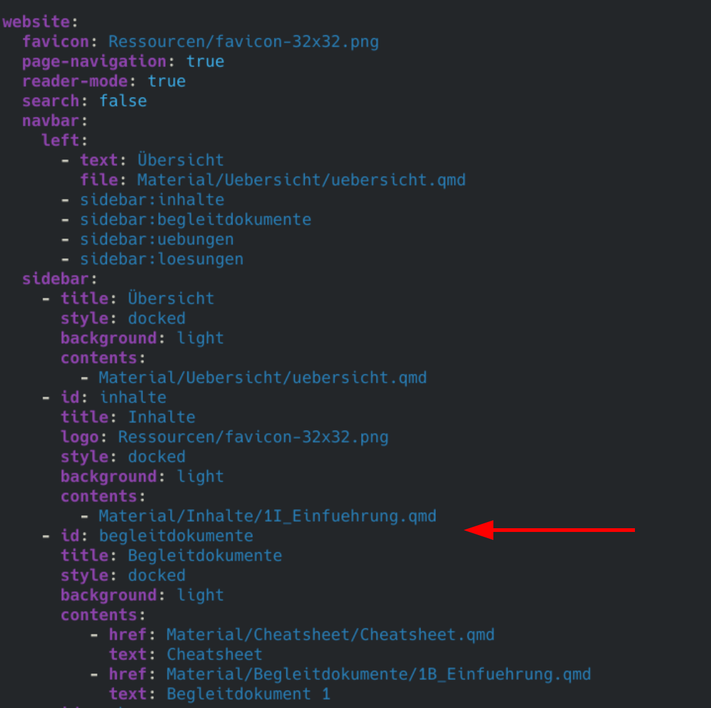
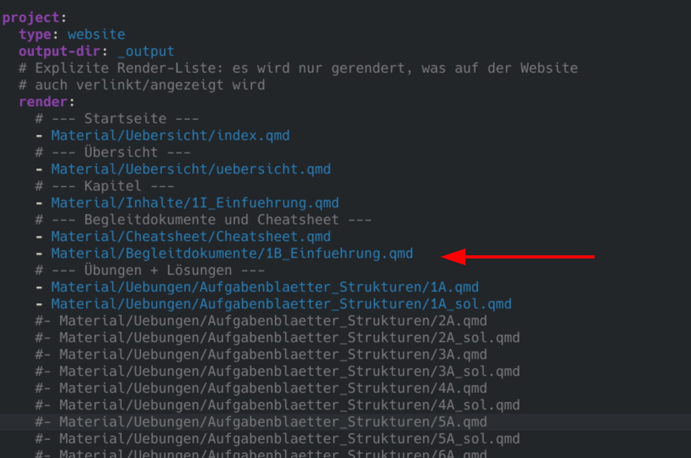
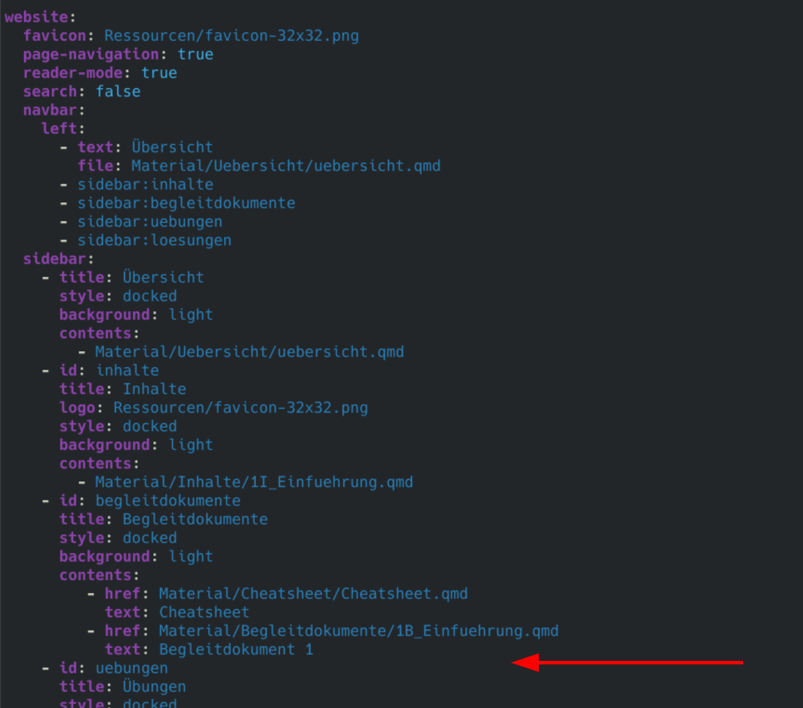
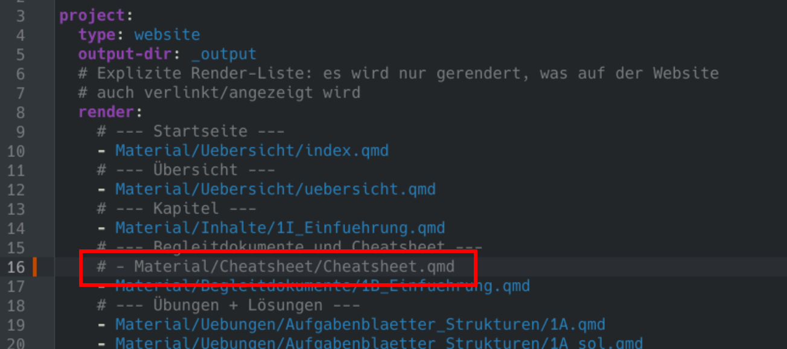
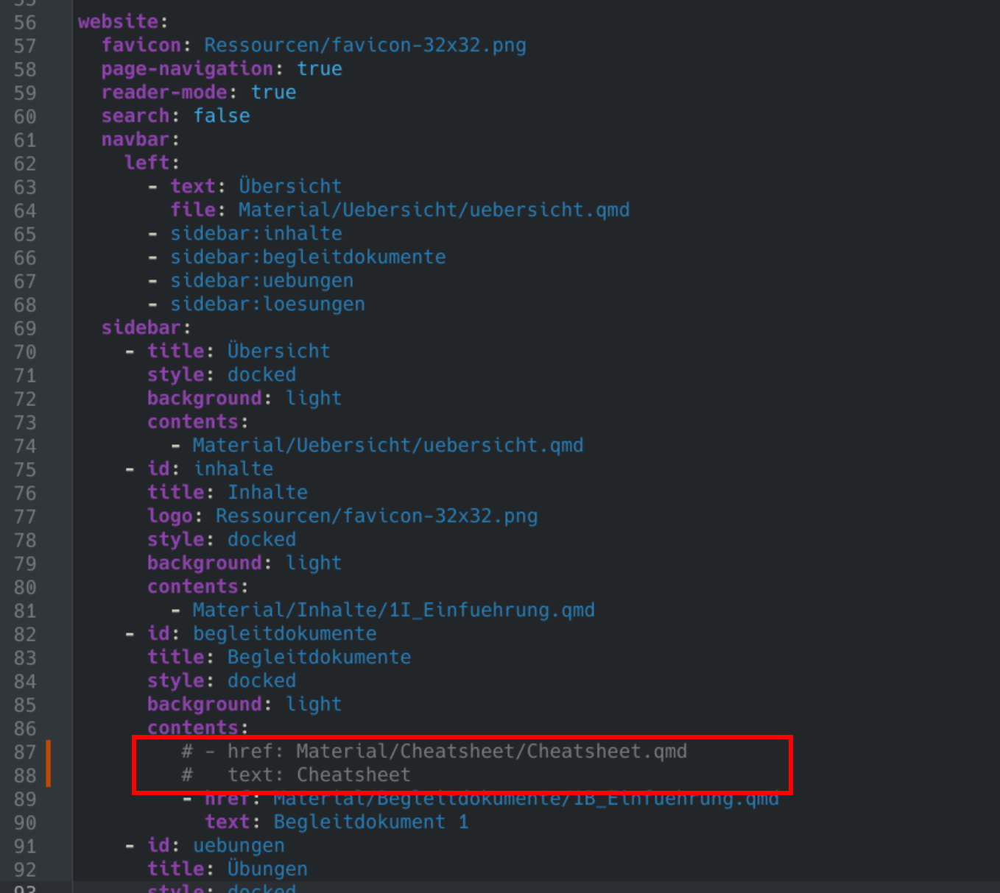
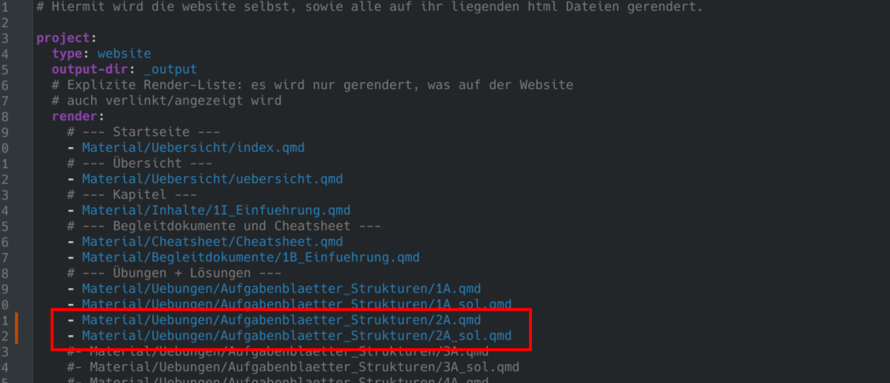
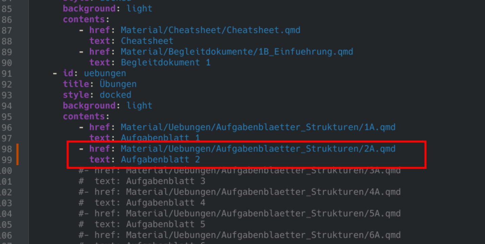
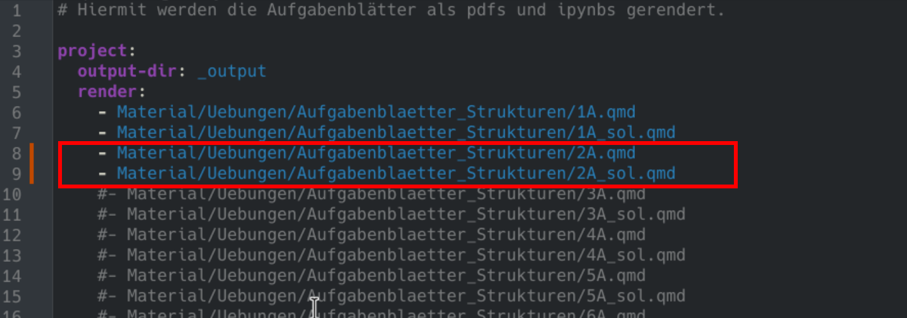

# Strukturelle Anpassungen

Das strukturelle Anpassen der Seite - primär durch das Bearbeiten der quarto-Dateien - ist der Teil, welcher auf das gelieferte Artefakt den größten Einfluss hat. Dieses Kapitel behandelt ausführlich Anpassungen, die Sie vermutlich vornehmen möchten.

## Neues Inhaltskapitel hinzufügen

### Neues Dokument erstellen

Wenn Sie ein neues Kapitel hinzufügen wollen, muss dieses zum einen gerendert werden und zum anderen von der Website aus erreichbar sein.

Navigieren Sie sich zunächst in den *Material/Inhalte* Ordner. Erstellen Sie hier nun ein neues Dokument. Es sollte immer mit einer Zahl anfangen, von einem I für Inhalte und einem Unterstrich gefolgt und mit einem passenden Namen für das Kapitel abgeschlossen werden.

Ein Beispiel für ein zweites Kapitel wäre: "2I_Stochastik_Einführung.qmd".

Öffnen Sie nun das neu erstellte Dokument und fügen Sie oben einen wie folgenden Text ein:

```
---
title: "Kapitel 1: Einführung"
other-links:
  - text: Kapitel 1
    href: 1I_Einfuehrung.pdf
    icon: file-pdf
---
```

Ändern Sie die Angaben entsprechend. Die href muss zum Dokumententitel passen. Der title wird unter anderem oben im Dokument angezeigt.

### Rendering anpassen

Öffnen Sie nun wieder im Ursprungspfad *_quarto-skript.yml*. 

Zunächst muss dafür gesorgt werden, dass das Dokument gerendert wird. Fügen Sie dafür unter *projekt:render:* den neuen Pfad der qmd hinzu.



Damit das Dokument nun auch auf der Website verlinkt ist, muss es außerdem unter *website:sidebar:* am Punkt *id: inhalte* unter dem Attribut *contents* stehen.



## Neues Begleitdokument hinzfügen

### Neues Dokument erstellen

Begleitdokumente werden sehr ähnlich erstellt wie Inhaltskapitel.

Navigieren Sie sich zunächst in den *Material/Begleitdokumente* Ordner. Erstellen Sie hier nun ein neues Dokument.

Ein Beispiel für ein zweites Kapitel wäre: "2B_Stochastik_Einführung.qmd".

Fügen Sie oben ins Kapitel folgenden Text ein und ändern sie die Angaben wieder entsprechend:

```
---
title: Begleitdokument 1
other-links:
  - text: Begleitdokument 1
    href: 1B_Einfuehrung.pdf
    icon: file-pdf
code-links:
  - text: Begleitnotebook 1
    href: 1B_Einfuehrung.ipynb
    type: application/octet-stream
    icon: file-code
downloads: [ipynb]
---
```

### Rendering anpassen

Fügen Sie jetzt wie bei den Inhaltskapiteln dieses mal das neue Begleitdokument hinzu:





## Cheatsheet entfernen

Eventuell können Sie sich jetzt bereits denken, wie man das Cheatsheet entfernt. Den Prozess zum Hinzufügen eines Begleitdokuments muss man hier nur rückwärts anwenden, da das Cheatsheet mehr oder weniger wie eins funktioniert. 

Zunächst muss man das Cheatsheet rendering auskommentieren:



Dann die Verlinkung auf der Website:



## Neues Übungsblatt erstellen

Ein neues Übungsblatt zu erstellen funktioniert sehr ähnlich, aber etwas anders. 

Erstellen Sie unter *Material/Uebungen/Aufgabenblaetter* eine neue content-Datei. Für ein zweites Übungsblatt wäre das 2A_content.qmd. Es ist in der Datei selbst oben kein Header nötig.

Kommentieren Sie die dazugehörigen Übungblätter in *_quarto-skript.yml* einmal beim rendering...



und einmal bei der Website wieder ein.



Außerdem muss hier dieses Mal auch in *_quarto-aufgaben.yml* das entsprechende Blatt wieder einkommentiert werden.



## Überprüfen

Denken Sie daran, die neu erstellen Dokumente zu prüfen. Am einfachsten geht das, indem Sie diese einzeln rendern. Wie das geht erfuhren Sie bereits im Vorkapitel unter dem Punkt "Änderungen prüfen".

## Navigation

[Vorseite](./inhaltliche-anpassungen.md) / [Nachseite](./erweiterte-strukturelle-anpassungen.md)
